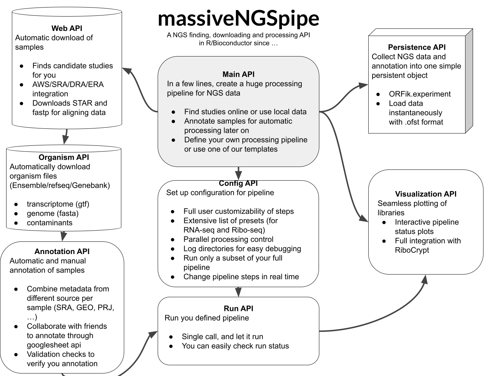

# massiveNGSpipe

massiveNGSpipe processes Ribo-seq, RNA-seq, disome and small-subunit (SSU) sequencing studies in bulk: thousands of
samples from many studies and organisms in one run. It is built on [ORFik](https://github.com/Roleren/ORFik), and its
output can be browsed directly in [RiboCrypt](https://github.com/m-swirski/RiboCrypt) ([ribocrypt.org](https://ribocrypt.org/)).

For each study and organism it:

- finds and curates sample metadata (SRA/ENA/GEO run tables, or a CSV for local data), with optional Google sheet sync;
- downloads the reference genome and annotation, and builds the STAR index;
- downloads the reads (AWS, ENA, then fasterq-dump);
- detects adapters, barcodes and UMIs, then trims and collapses the reads;
- aligns with STAR and builds an ORFik experiment;
- converts to ofst, P-shifts and validates footprints (Ribo-seq);
- builds the study pool, coverage (covRle, bigWig) and count tables;
- merges organism-wide tracks and collections for RiboCrypt.

Every stage sets a flag, so a stopped or failed run resumes where it left off.

The API is still under development and can change.

## Install

Requirements:

- Linux or macOS (on Windows, use WSL2);
- R >= 4.4;
- memory: 32 GB for large genomes such as human or mouse, 16 GB for small ones such as yeast or E. coli. Memory use
  grows with the number of workers.

```r
if (!requireNamespace("remotes", quietly = TRUE)) install.packages("remotes")
remotes::install_github("rc-biotech/massiveNGSpipe", upgrade = "never")
```

The `Remotes` field points ORFik, RiboCrypt, fst and fstcore to their development sources, and pins data.table to one
commit. `install_github()` installs these. `R CMD INSTALL` alone does not, so install them first in that case. To
compare these forks with released versions, use a separate R library.

ORFik decides where data is stored: `ORFik::config()` gives the fastq, bam (processed), reference and experiment
folders. The pipeline's own metadata, flags and logs go in a project folder, by default `NGS_pipeline` next to them.

## Quick start: command line

The `mngsp` command runs the pipeline from the shell, so you do not need an R launcher script. To put it on your PATH:

```bash
Rscript -e 'massiveNGSpipe::install_cli()'   # symlinks mngsp into ~/.local/bin
mngsp --help                                  # all commands
mngsp run --help                              # options of one command
```

From an empty folder to a processed example study (PRJNA779948, a human Ribo-seq study: 4 HeLa libraries, 6.8 M reads):

```bash
mngsp init ~/mngsp_demo              # writes mngsp.conf (every setting, commented) and studies.txt
cd ~/mngsp_demo
mngsp preflight                      # open-file limit, data folders, disk, memory, barcode detector self-test
mngsp curate studies.txt --organism "Homo sapiens"   # metadata into the FINAL list
mngsp plan studies.txt               # dry run: experiments, references, flags, next step
mngsp run studies.txt --apply --download-references --threads 16
mngsp status studies.txt             # stage table per experiment (mngsp status: last session checklist)
mngsp errors                         # error records of the last session, with hints
mngsp retry PRJNA779948-homo_sapiens # clear the record after fixing the cause
mngsp run studies.txt --apply --reset    # re-trim from scratch: clears flags, outputs and errors
```

If validation fails, curation stops. Edit `project/next_round_manual.csv` (`KEEP`, `LIBRARYTYPE`, `CONDITION`,
`REPLICATE`, ...), then run `mngsp curate studies.txt --validate-only`.

### Commands

| Command | Purpose |
| --- | --- |
| `init <dir>` | Create a project folder with `mngsp.conf` and an example `studies.txt`. |
| `curate <list>` | Download metadata and validate it into the FINAL list (no Google sheet unless `--google-sheet <url>`). |
| `plan <list>` | Dry run. It writes only `<project>/mngsp_plan_<list>.csv`. |
| `run <list>` | The same as `plan` without `--apply`. With `--apply`, it runs the pipeline. Exit status: 0 done, 2 finished with error records, 1 failed. |
| `status [<list>]` | Without a list: the checklist of the last session. With a list: flags done, next step and errors per experiment. |
| `errors` | Error records of a session (`--session n`), and the event log (`--events n`). |
| `retry <exp>... \| --all` | Clear error records. A running pipeline retries those experiments on its next round. |
| `preflight` | System checks and the barcode detector self-test. |
| `config [<list>]` | Every resolved setting and where it came from. |
| `resources show \| set <mode> --reason <text> [--hours h] \| refresh \| clear` | Show or change the server-wide resource mode (see [Resources and server mode](#resources-and-server-mode)). |

A study list holds one accession per line: a BioProject, GEO series or SRA study in online mode, or a folder name in
local mode. Lines starting with `#` are comments.

Main `run` options:

| Option | Effect |
| --- | --- |
| `--apply` | Run. Without it, `run` is a dry run. |
| `--reset` | Full restart: clears flags, per-sample markers, errors, the study folder and the experiment CSV. It has no effect without `--apply`. |
| `--keep <file>` | Studies that are never reset or run. |
| `--trim <file>` | Manual trim table (`BioProject, adapter, barcode5p_size, barcode3p_size, mate, reverse, status`). Status `apply` is used before trimming; `hold` skips the study. |
| `--manual-dir <dir>` | Per-experiment `barcodes_manual.csv`, `adapters_manual.csv` and `mate_override_manual.csv`, copied into `<experiment>/trim/`. |
| `--organisms <csv>` | `BioProject,ScientificName`: only these experiments of studies with several organisms. |
| `--exclude-runs <csv>` | Runs that are never processed (`Run` column). |
| `--skip-failed <n\|date>` | Skip studies that failed in the last n sessions, or since a date. |
| `--download-references` | Fetch missing genomes and build missing STAR indices. By default, studies without a complete reference are skipped. |
| `--no-preflight` | Skip the barcode detector self-test, which runs by default for Ribo-seq, disome and SSU. |
| `--threads <n>`, `--threads-<step> <n>`, `--blas-cap <n>` | Workers per stage, workers for one step (`trim`, `collapse`, `pshifted`, `pcounts`, ...), and BLAS threads. |
| `--ram-reserve-gb`, `--bam-sort-memory-gb`, `--max-ram-wait-minutes` | Memory caps for alignment. |
| `--no-dynamic-thread-count` | Use the configured thread counts exactly (no load-based counts, no resource mode). |

All `pipeline_config()` arguments are available as options (`--preset`, `--mode`, `--project-dir`,
`--split-unique-mappers`, `--delete-raw-files`, ...). Their defaults are the `pipeline_config()` defaults.

### Settings files

Settings are applied in this order, and later sources win:

1. the `pipeline_config()` defaults;
2. `mngsp.conf` in the study list's folder;
3. `<list>.conf` next to the list;
4. `#: key: value` lines inside the list;
5. `--config <file>`;
6. command-line flags.

A settings file holds one `key: value` per line. Keys are the option names, written with dashes or underscores.
Relative paths are relative to the file. `--apply` and `--reset` are accepted only on the command line.

```
# mngsp.conf
preset: Ribo-seq
mode: online
split_unique_mappers: TRUE
max_unprocessed_downloads: 60
threads: 24
threads_pcounts: 1
ram_reserve_gb: 80
exclude_runs: keep_false_runs.csv
```

Run `mngsp config studies.txt` to see each value and its source.

### Batch runs

A batch runner script with flags maps one-to-one onto `mngsp run`. For example, this call:

```bash
Rscript run_study_list_v5.R wave01.txt --apply --reset --organisms organisms.csv --manual-dir manual_tables \
  --keep keep.txt --trim manual_trim.csv --skip-failed 1
```

becomes:

```bash
mngsp run wave01.txt --config batch.conf --apply --reset --organisms organisms.csv --manual-dir manual_tables \
  --keep keep.txt --trim manual_trim.csv --skip-failed 1
```

`batch.conf` holds the settings that the script hard-coded (`delete_trimmed_files`, `split_unique_mappers`,
`reuse_shifts_if_existing`, `exclude_runs`, ...). A `run --apply` writes these files:

- the plan: `<project>/mngsp_plan_<list>.csv`;
- the metadata subset: `subset_<list><subset_suffix>.csv`;
- the pre-flight report: `mngsp_preflight_<list>.csv`;
- provenance for each experiment: `<experiment>/trim/detector_provenance.csv` (versions, detector mode, pre-flight).

### Shell environment

The `mngsp` wrapper does three things before it starts R:

- it unsets `LC_ALL` (the same as `env -u LC_ALL`);
- it raises the open-file limit to 524288 (`MNGSP_NOFILE`), up to the hard limit. STAR needs many open files, and
  `run --apply` stops below 65535;
- it sets a 64 MB C stack.

If `ulimit -Hn` is lower than the limit you need, ask your administrator. To run a source checkout instead of the
installed package, set `MNGSP_DEV=<checkout>`. Start long runs in a job runner, `tmux` or `nohup`.

## Quick start: R

```r
library(massiveNGSpipe)
config <- pipeline_config(preset = "Ribo-seq")              # paths, stages, workers
accessions <- accessions_to_use("PRJNA779948", "Homo sapiens", massive_search = FALSE)
curate_metadata(accessions, config, "Homo sapiens")         # metadata into the FINAL list
pipelines <- pipeline_init_all(config)                       # references + one pipeline object per study
progress_report(pipelines, config)
run_pipeline(pipelines["PRJNA779948"], config, wait = 20)    # e.g. as an RStudio background job
```

`pipeline_init_all()` keys pipelines by `study_accession`, which is often a GEO series, not the BioProject. It also
downloads missing references. To skip studies whose reference is incomplete instead, set
`only_complete_genomes = TRUE, only_complete_indices = TRUE`. The functions behind the command line are
`study_list_plan()`, `study_list_reset()` and `preflight_detector()`.

### Local data

In local mode (`mode = "local"`) there is no download step, and raw files are never deleted by default. Each study is
a folder `<fastq>/<name>-<organism>/`. Describe its samples with `local_study_csv()` in
`<project>/metadata/SraRunInfo_<name>.csv`, then run `curate_metadata(name, config)`. A FINAL list row needs
`KEEP = TRUE` and a unique set of labels. See `?local_study_csv` and `?curate_metadata`.

## Configuration

`pipeline_config()` sets up the following. See `?pipeline_config` for every argument.

- **Folders:** `project_dir` (FINAL list, flags, logs, errors) and the ORFik data folders (`config`). Keep one project
  folder per modality (`NGS_pipeline`, `NGS_pipeline_RNA`, ...).
- **Preset:** `"Ribo-seq"`, `"RNA-seq"`, `"disome"` or `"SSU"`. The preset decides the stages; see the next section.
- **Mode:** `"online"` processes public studies and deletes raw, trimmed and collapsed files after use, because they
  can be downloaded again. `"local"` processes your own FASTQ files and keeps everything.
- **Mappers:** `all_mappers` and `split_unique_mappers` choose which outputs are made. All-mapper totals count every
  alignment of a multi-mapping read, so use the unique-mapper outputs for depth.
- **Workers:**
  - `threads_default` is the number of workers per stage;
  - `threads` overrides the count for one step, e.g. `config$threads$pcounts <- 1`;
  - `threads_blas_cap` caps the BLAS threads of each worker, and the workers of the P-shift and count stages;
  - `thread_type` selects multicore or serial.
- **Memory:** an alignment waits until enough memory is free, for at most `max_ram_wait_minutes`. Optional fields on
  the config list:
  - `config$ram_reserve_gb`: memory to leave free for other users;
  - `config$bam_sort_memory_gb`: a cap on the BAM sort;
  - `config$external_bam_sort_gb`: the memory budget of the external sorter.
- **Downloads:** `max_unprocessed_downloads` and `stop_downloading_new_data_at_drive_usage` pause new downloads.
- **Google sheets:** `google_url` syncs the curated metadata. With `NULL`, local CSV files are used; the command line
  never creates a sheet.

## Resources and server mode

All thread and worker counts go through one function, `resource_threads(step, max = <configured value>)`
(`R/resources.R`). Step names and their per-worker costs are listed by `resource_steps()`; new code calls
`resource_threads("my_step", max = n)` (unknown steps use the `default` row).

- **The configured value is the maximum.** With `pipeline_config(dynamic_thread_count = TRUE)` (default) the count
  is load-based: `min(max, max(min, floor((cores - load1) / cores_per_worker)), floor((MemAvailable - reserve) /
  per_worker_gb), n)`, at least 1. The reserve is `options(massiveNGSpipe.mem_reserve_gb)`, default 80 GB. The busy
  floor `min` applies to the CPU check only; too little memory can go down to 1. On an idle host the result is the
  configured value. `resource_snapshot()` shows cores, load, MemAvailable, swap and the mode.
- **`dynamic_thread_count = FALSE`** (`--no-dynamic-thread-count`): the configured values exactly, ignoring load
  and the mode file.
- **STAR:** `--runThreadN` is ORFik's default `min(90, workers)` through `resource_threads("star")`. The BAM sort uses
  `--outBAMsortingThreadN 16` (`config$star_sort_threads`, passed through `ORFIK_STAR_EXTRA_ARGS`; a value set there
  by the user wins). This is 17% faster on heavy libraries and gives the same BAM bytes, but peaks at about 30 GB
  instead of 16 GB, so it falls back to STAR's 6 when less than `config$star_sort_extra_gb` (14 GB) is left after
  the planned sort.
- **SSD scratch:** an alignment uses the SSD only when it has the input copy, plus ~1 GB per million input reads
  (`config$scratch_gb_per_million_reads`; reads estimated from the file size), plus `ssd_min_free_gb`. STAR's temp
  files grow with the number of alignments (54 GB for a 68 M-read library), not with the FASTQ size. Before this, the
  check was 2x the input plus `ssd_min_free_gb`.

**Server mode file (optional).** `~/livemount/Bio_data/NGS_pipeline/RESOURCE_MODE` is on the shared storage of all
konsola containers. Set `options(massiveNGSpipe.resource_mode_file =)` or the env var `MNGSP_RESOURCE_MODE_FILE` to
point elsewhere, or to `none` to disable reading it. With no file, nothing extra is capped. A valid file is a master
regulator on top of the load-based counts and only ever lowers them:

```
mode: conserve            # normal (only the caps below) | conserve (x0.5 of every maximum) | minimal (x0.25)
max_mem_gb: 40            # optional: memory per step (workers x per-worker GB, STAR sort; larger sorts go external)
max_threads: 16           # optional: threads / workers per step
reason: ribocrypt VM stalled
set_by: claude-megafst
set_at: 2026-11-24T12:00:00Z
expires_at: 2026-11-24T14:00:00Z
```

- **Writing it:** `resource_mode_set("conserve", hours = 2, reason = ...)`, `resource_mode_refresh()`,
  `resource_mode_clear()`, `resource_mode_show()`, or `mngsp resources set|refresh|clear|show`.
  - The file is written atomically (temp file in the same folder + rename), so readers never see half a file.
  - With concurrent writers, the last rename wins.
  - `clear --set-by <me>` only clears a mode that `<me>` set.
  - Every change is appended to `RESOURCE_MODE.log`.
- **Expiry and heartbeat:**
  - `expires_at` is required and may be at most 6 h after `set_at` (`massiveNGSpipe.resource_mode_max_hours`), so a
    crashed writer cannot leave a lasting restriction.
  - The writer must refresh the file to keep the mode.
- **Files that are ignored** (one warning per file version, then treated as no file):
  - expired, malformed, unreadable (e.g. a permission error), or with expiry too far ahead;
  - future-dated: `set_at` more than 10 min in the future, which means the clocks of the containers differ.
  - `options(massiveNGSpipe.resource_mode_rename_expired = TRUE)` renames an expired file to `RESOURCE_MODE.expired`.
- **When it is read:** at every thread decision, i.e. at each stage start (`bpparam_from_config()`) and for each
  alignment. It is one stat and one small read, and it never fails a run.
  - A mode change applies from the next stage or sample; running work is not touched.
  - NFS attribute caching can delay a change by up to about a minute.
- **Valen** and other hosts without the shared path have no file, so they get the load-based counts only.
- **The `resource_budget.py` claims** (`open_workspace/agent_mail/resources/`) are separate and are not merged with
  the mode file. Claims reserve capacity per agent group before heavy jobs start. The mode file throttles running
  pipelines server-wide. `ram_reserve_gb()` still reads the budget's `reserve_gb` for alignments.

Call sites, file:line on branch `feature/resource-mode-20261124` (before → after):

| Site | Step | Before | After |
| --- | --- | --- | --- |
| `R/pipeline_init_helpers.R:421` `bpparam_from_config()` | each `config$threads` name (main, trim, collapse, pshifted, valid_pshift, pcounts, ofst, covrle, ...) | `config$threads[[step]]` | load-based, max = config value; also re-applies BLAS when a mode is active |
| `R/pipeline_config.R:292` BLAS/OpenMP | blas | `threads_blas_cap` | load-based, max = `threads_blas_cap` |
| `R/pipeline_preset_steps_sub.R:453` STAR `--runThreadN` | star | ORFik default `min(90, workers)` | same value as max, passed as `max.cpus` |
| `R/pipeline_preset_steps_sub.R:454` STAR sort | star_sort | STAR default 6 | 16 when ≥14 GB headroom, else 6 |
| `R/pipeline_preset_steps_sub.R:229` SSD scratch | - | 2 x input + 50 GB | input + 1 GB/M reads + 50 GB |
| `R/pipeline_align_memory.R:174` external BAM sort | - | `external_bam_sort_gb` (16) | x mode factor, ≤ `max_mem_gb` (mode only) |
| `R/pipeline_collapse.R:113` fast collapse | collapse_fast | `config$threads$collapse` | load-based |
| `R/pipeline_trim_parallel.R:284-288` `trim_workers_dynamic()` | trim_workers | own formula (4 cores, 8 GB, floor 2, max 8) | same parameters in the shared formula + mode cap |
| `R/pipeline_preset_steps.R:786-789` `derive_threads_dynamic()` | ofst_derive | own formula (2 GB, floor 4, max 16) | same parameters in the shared formula + mode cap |
| `R/trimcollapse.R:32` | trimcollapse | `min(16, cores)` | load-based |
| `R/fastq_helpers.R:1280,1401,1465`, `R/anchored_front_trim.R:38`, `R/barcode_trim_order.R:6` | fastp | ORFik default / 4 | load-based |
| `R/download_sra.R:197` fasterq-dump | fasterq_dump | 24 (temp) / 6 | load-based |
| `R/pipeline_demultiplex.R:88-89` | demultiplex | 4 files / 8 collapse workers | load-based |
| `R/pipeline_preset_steps.R:247,334`, `R/collection_megafst.R:303`, `R/collection_processing.R:81` | collection | `bpparam()$workers` / 4 | load-based |
| `R/pipeline_preset_steps.R:399`, `R/collection_megafst.R:533`, `R/collection_processing.R:11,84` | io | qs2 / fst 5 threads | load-based |
| `R/metadata_qc_table.R:34` | qc_table | 16 | load-based |
| `R/pipeline_metadata.R:855` | metadata | 3 (NCBI rate limit) | mode cap only (no CPU check) |
| `R/bam_utils.R:442`, `R/annotation_build.R:192,298` | star, blast | 20, 8 | load-based |

Not routed:
- the UMAP threads (`collection_umap.R`), because uwot's neighbour search can change results with the thread count;
- the ORFik-internal counts that ORFik sets itself.

## Stages, flags and status

| Preset | Stages (flags) |
| --- | --- |
| Ribo-seq | start, fetch → trim, collapsed → aligned, cleanbam → exp, ofst → pshifted, valid_pshift → merged_lib → covrle, bigwig → pcounts |
| RNA-seq | start, fetch → aligned, cleanbam → exp, ofst → cigar_collapse → merged_lib → covrle, bigwig → pcounts |
| disome, SSU | as Ribo-seq, without the P-shift stages |

`start` and `fetch` exist only in online mode. `demultiplex = TRUE` adds a demultiplexing stage first (see
`?demultiplex`), and `contam = TRUE` adds contaminant depletion before alignment.

**Flags.** Each finished stage writes `<project>/flags/<stage>/<experiment>.rds`. Per-sample markers let reruns skip
finished samples. Removing flags triggers reprocessing:

- `remove_flag_all_exp(config, steps, exps, samples = TRUE)` removes flags and per-sample markers;
- `remove_flag_all_exp_from(config, from_step, exps)` removes the flag of one stage and every stage after it.

After changing offsets or trimming, use `samples = TRUE`, or the coverage and counts stay stale.

**Status.** To follow progress:

- `mngsp status`, or `<project>/log_pipeline/checklist.txt`, shows each stage's progress and the system load;
- `watch_pipeline_checklist(config)` follows it live;
- `progress_report(pipelines, config)` gives a summary per study.

## Trimming and barcode detection

- **Adapters** are detected from the first 200k raw reads (`adapter_detection = "scan"`; `"fastqc"` is the older
  method).
- **Single-end reads** are trimmed and collapsed in one pass by a built-in C program (`fast_trim = TRUE`). Paired-end
  reads use fastp.
- **Paired footprint libraries** are processed from one mate (`auto_footprint_mate = TRUE`).

The libraries of one experiment are trimmed several at a time (`trim_parallel = "staged"`, the default and fastest: a detection stage feeds a pool of trim/collapse workers, largest library first). The worker count is chosen from idle CPUs and free memory (about 8 GB per worker); set `trim_workers` (`--trim-workers` on the command line) to fix it, or `trim_parallel = "serial"` for one library at a time.

The barcode/UMI detector runs in `"guarded"` mode by default:

- it cuts only on sequence evidence, where a fixed run plus non-templated (random) bases mark the barcode;
- it rejects calls instead of clipping them;
- it guards the read length after trimming, and falls back to poly(A) detection.

`options(massiveNGSpipe.barcode_detector = "legacy")` restores the older change-point detector.
`preflight_detector()`, also run by `mngsp preflight` and `mngsp run`, checks the detector on a synthetic library with
a random 4-nt 5' flank.

For each experiment, `<experiment>/trim/adapter_barcode_table.csv` records what was detected. To override detection,
put a manual table in the experiment's `trim/` folder: `adapters_manual.csv`, `barcodes_manual.csv` or
`mate_override_manual.csv`. Then:

- `apply_trim_fix_to_sample(exp, run, config, barcode5p_size =, barcode3p_size =, adapter =, note =)` fixes one
  sample and resets only that sample's markers;
- `apply_trim_fix_and_rerun()` also reruns the study and checks that no sibling sample changed;
- to re-trim whole studies, use `mngsp run --apply --reset --trim <table>` or `--manual-dir <dir>`.

## P-shifting

For Ribo-seq, ORFik detects the P-site offset of each read length (`accepted_lengths_rpf`), first strict, then weak.
With `pshift_per_library = TRUE`, a study-wide failure falls back to per-library detection. Mitoribosome libraries
(FRACTION `mito`) are shifted on mitochondrial CDSs.

The results are in `aligned/pshifted/`: `shifting_table.rds` with its provenance, and the weighted read-length
distributions. `valid_pshift` marks that the QC was computed, not that it passed.

For review and repair:

- `pshift_triage(exp, config)` collects the QC verdict, frame table and length distributions (read-only);
- `manual_reshift(exp, offsets, config, note)` applies explicit offsets, resets the downstream stages and logs the
  change;
- `pshift_add_extra_lengths()` adds read lengths;
- `psite_reshift_app()` is an interactive review app.

## Outputs

For each experiment `<study>-<organism>`, in the bam folder of `ORFik::config()`:

| Path | Content |
| --- | --- |
| `trim/` | Trim reports, detected and manual adapter/barcode tables, provenance. |
| `aligned/*.bam`, `aligned/LOGS_*` | STAR alignments and logs. |
| `aligned/ofst/`, `aligned/pshifted/` | Collapsed alignments (ofst; `score` = read count) and P-shifted reads. |
| `aligned/cov_RLE*/`, `aligned/bigwig/` | Coverage for fast loading and genome browsers. |
| `aligned/QC_STATS/` | Count tables (`countTable_<mrna\|cds\|leaders\|trailers>.qs`), STAR and frame QC. |
| `aligned/unique_mappers/` | The same products for unique mappers (with `split_unique_mappers`). |

The ORFik experiment CSV (`<exp folder>/<experiment>.csv`) ties samples to their labels. Load it with
`ORFik::read.experiment()`.

## Merged tracks and collections

When studies are done (`pcounts`), you can build organism-wide products:

- `pipeline_merge_org(config)`: merged masters for each organism, plus subsets such as one inhibitor;
- `pipeline_collection_org()` and `pipeline_collection_master()`: indexed collections for RiboCrypt's MegaBrowser
  and UMAP;
- `docker_copy_done_experiments(config)`: publishes experiment CSVs to a RiboCrypt app's experiment folder,
  rewriting paths.

Building tracks, exposing them in an app and uploading a release are separate steps.

## Troubleshooting

- **A study failed.**
  1. Run `mngsp errors`, or `pipeline_errors(config)` in R. Error records are in
     `<project>/error_logs/<session>/<experiment>.rds`, and stage loops skip studies that have one.
  2. Fix the cause, then run `mngsp retry <experiment>` (`clear_pipeline_error()`). A running pipeline picks the
     study up again; otherwise start `mngsp run <list> --apply`.
  3. To leave known failures out of a restart, use `--skip-failed 1`.

  All events go to `error_logs/events.jsonl`, and run-level crashes to `session_logs/<session>/crash_*.rds`.
- **Wrong trimming or offsets.** For a full restart, run `mngsp run <list> --apply --reset`. For one sample, use
  `apply_trim_fix_to_sample()`. For a later stage, use `remove_flag_all_exp_from()`.
- **"Too many open files", or STAR stops.** Raise `ulimit -n`. `mngsp preflight` shows the current limit.
- **"C stack usage too close to the limit".** Start R with `ulimit -s 65536`; the `mngsp` wrapper does this.
- **"unable to fork" or zombie processes.** Long runs mix callr and forked workers. The stage loops reap their own
  zombie children automatically, so update the package if this still happens. Stop a run by its whole process tree,
  because STAR, fastp and fasterq-dump run in their own sessions.
- **Genome download failed.** Run `get_annotation(organism)` to see why. Otherwise, place the FASTA and GTF yourself:
  `get_annotation(organism, GTF = <gtf>, genome = <fasta>)`. Some organisms need a pinned assembly
  (`reference_assembly()`).
- **Temp space.** SRA extraction uses `tempdir()` only when `tmp_space_claim()` grants the space. `tmp_cleanup_stale()`
  removes stale `Rtmp*` folders left by dead sessions.
- **RNA strand.** See [RNA_STRAND.md](RNA_STRAND.md).

## Development and tests

Use `devtools::load_all()` on a checkout, or `MNGSP_DEV=<checkout> mngsp ...` for the command line. To add a custom
stage, use `add_step_to_pipeline(config, short_name, FUN)`.

```r
devtools::test(filter = "cli")   # one test file
devtools::test()                 # full suite
```

The tests use temporary folders and mock data; they need no network or references.

## Authors and license

Håkon Tjeldnes and Michał Świrski, with contributions from Krzysztof Starecki. MIT license (see `LICENSE`).
